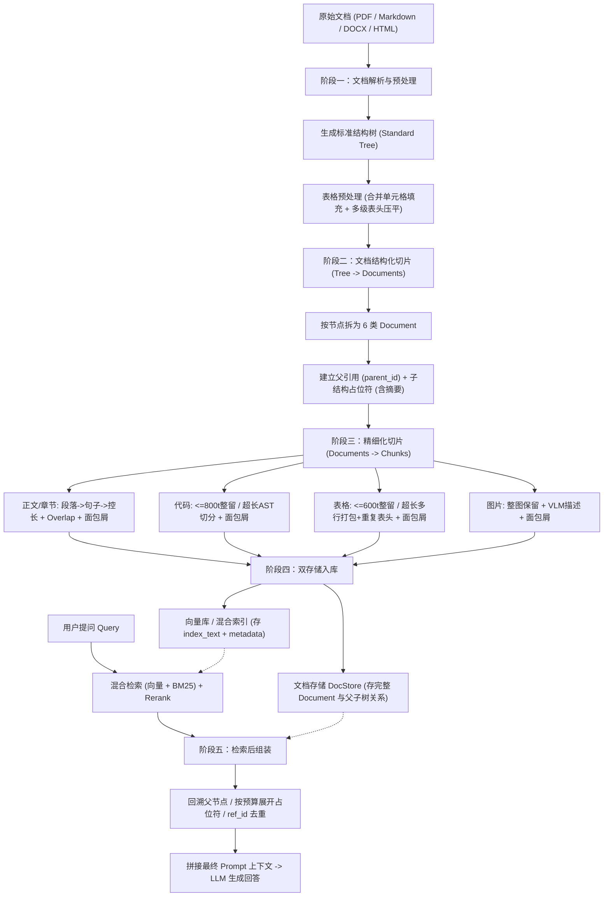

# 文档结构化与精细化切片系统 — 技术设计文档

> **文档状态**：正式设计稿 v1.0  
> **适用技术栈**：Python 3.13+、Pydantic v2、Milvus（已集成 `milvus-lite` / `pymilvus`）、LangChain / LlamaIndex / LangGraph  
> **阅读说明**：本文档同时兼顾**工程严谨性**与**新手可读性**，包含完整的架构设计、数据结构、阈值规范、API 选型指南与从 0 到 1 的分步落地路线。

---

## 1. 背景与设计目标

### 1.1 为什么传统的“按字数切片”不够好？

在传统的入门级 RAG（检索增强生成）系统中，常见做法是把整篇文档提取成纯文本，然后每 500 字硬切一刀。这种方式在真实业务文档（技术手册、产品文档、PDF 讲义、知识库）中会造成 4 个致命问题：

1. **丢失标题归属**：切出来的段落不知道自己属于哪一章（例如写着“将其设置为 `true`”，但不知道在配置哪个功能）。
2. **腰斩图表与代码**：一个 30 行的表格或代码块被从中间切断，丢失表头或函数定义，大模型根本看不懂。
3. **跨段落语义断层**：上下文说明和紧跟其后的表格/图片被切到不同块里，导致搜不到或答不全。
4. **父子信息难以联动**：召回了一段代码，却找不到代码前后的使用说明；召回了章节概要，却看不到里面引用的表格数值。

### 1.2 本方案的核心目标（Best Practice）

本方案采用**“两阶段结构化切片 + 全模态面包屑 + 检索后组装”**架构，目标如下：

- **结构保真**：先把任意文档解析为“标准结构树”，再按文档逻辑结构拆解，保留**父引用**与**子结构占位**。
- **模态解耦**：正文、代码、表格、图片各自采用最适合自己的切分与打包策略。
- **上下文不丢**：**所有模态（含图片、代码、表格）**统一注入标题面包屑路径，且分离“用于检索的增强文本”与“喂给大模型的干净原文”。
- **边界可控**：针对超长代码、超大表格、空壳标题设置明确阈值和兜底规则，不撑爆 Embedding 窗口，也不产生检索噪声。

---

## 2. 系统总体架构与数据流

整个系统分为 **离线入库（5 个步骤）** 与 **在线检索组装（3 个步骤）** 两部分：



---

## 3. 阶段一：文档解析与标准结构树

> **小白理解**：不管原始文件是 PDF、Word 还是 Markdown，我们都不直接切字符串，而是先统一翻译成一棵“目录树”，就像书的目录和段落大纲一样。

### 3.1 标准结构树节点定义

解析器将文档统一转换为由以下 6 种基础节点组成的树：

| 节点类型 (`node_type`) | 含义 | 是否独立生成 Document |
| :--- | :--- | :--- |
| `page` | 文档根节点 / 页面 | 是（若含实质正文） |
| `heading` | 章节标题（H1 ~ H6）及其直属正文 | 是（纯空壳标题仅作元数据结构，不入向量库） |
| `paragraph` | 普通段落文本（灰色正文） | 否（归属到其父级 `page` 或 `heading` 内） |
| `code` | 代码块 / 配置文件块 | 是 |
| `table` | 表格块 | 是 |
| `image` | 图片及其图注/说明 | 是 |

### 3.2 关键预处理：表格归一化（防踩坑核心）

很多真实文档里的表格并不是简单的“第一行是表头”。在进入切分前，必须对表格做两步标准化：

1. **合并单元格展开填充**：如果某一行/列存在跨行（`rowspan`）或跨列（`colspan`）合并，解析时把值复制到每一个被覆盖的单元格中，消除空洞。
2. **多级表头压平**：如果表头占了 2~3 行（例如大类“电气参数”下分“功率”、“电压”），压平成单行表头：`电气参数-功率 | 电气参数-电压`。
3. **竖表识别（可选增强）**：若左侧首列为字段名、右侧为值（如产品参数卡片），保留为 `属性: 值` 形式或标记为 KV 表，避免误把第一行当表头。

---

## 4. 阶段二：文档结构化切片（Tree → Documents）

此阶段把“标准结构树”转化为一组带**父子拓扑关系**的逻辑 `Document`。

### 4.1 拆解规则

1. **彩色节点 → 独立 Document**：`page`、`heading`、`code`、`table`、`image` 各自生成独立的 `StructuredDocument`，并分配唯一 `doc_id`。
2. **父引用（向上指）**：每个 Document 记录 `parent_id`（例如代码、表格、图片、子标题都指向其直属上级章节 `heading`）。
3. **子结构占位（向下指）**：父节点（如“标题 A”）正文中遇到代码、表格、图片或子章节时，**不把子内容全文塞进父节点**，而是原地插入带**轻量摘要**的占位符：
   ```text
   前文说明内容...
   {{REF:doc_table_04|类型=表格|摘要=产品型号功率与防护等级参数表}}
   后文补充内容...
   {{REF:doc_heading_06|类型=子章节|摘要=子标题 A.1 安装注意事项}}
   ```
   > **为什么要带摘要而不只写 ID？**  
   > 既能帮父节点本身在检索时更容易被搜到，也能让大模型（或 Agent）一眼看出这个占位符里是什么，按需决定是否展开。
4. **空壳节点处理**：如果某个标题下面**没有任何前文/后文**（例如一级标题紧接着二级标题），该节点仍然保留在 `DocStore` 中用于维护面包屑路径和树结构，但标记 `indexable = False`，**不写入向量库**，避免产生无意义的检索噪声。

---

## 5. 阶段三：精细化切片（Documents → Chunks）

这是决定 RAG 检索准确率的核心环节。每个 `indexable = True` 的 `StructuredDocument` 会根据自身模态，切成最终入向量库的 `Chunk`。

### 5.1 核心机制一：全模态统一面包屑注入

**所有 5 种类型（页面、章节、图片、代码、表格）** 的每一个 Chunk，都必须带上统一的上下文头部：

```text
[路径] 产品手册 / 安装指南 / 参数说明
[类型] 表格
[上下文] 以下为不同型号设备的功率与防护等级对照表：
---
| 型号 | 功率 | 防护 |
| A100 | 10 W | IP54 |
| A200 | 20 W | IP65 |
```

- **`[路径]`**：从根节点到当前父节点的完整标题面包屑（用 ` / ` 拼接）。
- **`[类型]`**：明确标识正文、代码、表格或图片。
- **`[上下文]`**（针对图片/代码/表格的强力增强）：自动抓取该元素在父节点中**紧邻的前 1~2 句（≤ 80 tokens）或图注/表题**，彻底解决“表格/代码本身不含业务关键词导致搜不到”的问题。

### 5.2 核心机制二：`index_text` 与 `content` 分离

每个 Chunk 维护两个文本字段：
- **`index_text`（索引文本）**：包含 `[路径] + [类型] + [上下文] + 内容/描述`，专门用于计算 Embedding 向量和 BM25 关键词索引，最大化**召回率**。
- **`content`（展示文本）**：干净的原始片段（带轻量路径即可），用于最终拼装给 LLM，减少冗余噪声、节省 Token。

### 5.3 各模态精细化切分规则与阈值基线

> 以下 Token 阈值以主流 Embedding 模型（如 BGE-M3、Qwen-Embedding、`text-embedding-3`）的最佳信噪比区间 **300 ~ 600 tokens** 为基准，均应做成可配置参数。

| 模态类型 | 整体保留阈值 | 超长后的精细切分策略 | Overlap 重叠策略 |
| :--- | :--- | :--- | :--- |
| **页面 / 章节正文** | `≤ 500 tokens` | 递归切分：**段落 (`\n\n`) → 句子 (`。！？.!?\n`) → 强制字符控长**，目标块大小 `400 ~ 500 tokens`，每块继承完整面包屑 | `50 ~ 80 tokens`（约 10%~15%），保护跨句/跨引用语义 |
| **代码** | `≤ 800 tokens` | 1. **优先 AST 切分**：按编程语言语法树以**类 / 函数**为边界切分（目标 `500 ~ 600 tokens`），每块保留语言标识与所属类/函数签名；<br>2. **兜底切分**：无法解析 AST 的文本（如超长 JSON、YAML、报错日志）按空行或缩进层级切分 | AST 切分时 `0` 重叠；非 AST 兜底切分时保留 `5 ~ 10 行` 重叠 |
| **表格** | `≤ 600 tokens`（小表整留） | 1. **多行打包 + 表头重复**：不强行单行切分！每块固定携带**面包屑 + 压平后的首行表头**，往里逐行累加直到接近 `500 ~ 600 tokens` 封包；<br>2. **超宽单行兜底**：若单行本身超过 `600 tokens`，将其转为 `列名: 值` 键值对列表后按正文规则切分 | `0 行`（行与行通常独立；若有分组小计行则尽量同组打包） |
| **图片** | 整体保留 | 图片本身不拆；通过 VLM（多模态大模型）生成结构化描述 + OCR 文本。<br>若描述文本 `≤ 600 tokens`，整体作为一个 Chunk；若极长（如长截图 OCR `> 600 tokens`），按正文规则切分描述文本，所有子块共享同一个 `image_id` 与图片 URL/路径 | 仅描述超长切分时同正文 |

---

## 6. 核心数据模型设计（Pydantic v2）

以下是可直接用于 Python 项目的核心数据结构，定义清晰且自带类型校验：

```python
from enum import Enum
from typing import Any, Literal
from pydantic import BaseModel, Field


class NodeType(str, Enum):
    PAGE = "page"
    HEADING = "heading"
    PARAGRAPH = "paragraph"
    CODE = "code"
    TABLE = "table"
    IMAGE = "image"


class TreeNode(BaseModel):
    """阶段一输出：标准结构树节点"""
    node_id: str
    node_type: NodeType
    title: str | None = None              # 页面名或标题名
    level: int = 0                        # 标题层级：page=0, H1=1, H2=2...
    text: str = ""                        # 文本/代码/表格Markdown/图片描述
    raw_meta: dict[str, Any] = Field(default_factory=dict)  # 如代码语言、图片路径、页码、表格二维数组
    children: list["TreeNode"] = Field(default_factory=list)


class ChildRef(BaseModel):
    """父节点中记录的子结构占位信息"""
    ref_doc_id: str
    node_type: NodeType
    summary: str                          # 占位符轻量摘要，如“型号功率参数表”


class StructuredDocument(BaseModel):
    """阶段二输出：带父子关系和占位的逻辑文档（存入 DocStore）"""
    doc_id: str
    source_id: str                        # 原始文件名/URL
    node_type: NodeType
    parent_id: str | None = None          # 父引用
    breadcrumbs: list[str] = Field(default_factory=list)  # 如 ["产品手册", "安装指南"]
    content: str                          # 含 {{REF:...}} 占位符的正文，或完整代码/表格/图片描述
    surrounding_context: str = ""         # 针对代码/表格/图片，自动摘取的前后1-2句说明
    child_refs: list[ChildRef] = Field(default_factory=list)
    indexable: bool = True                # 空壳标题设为 False，不进向量库
    meta: dict[str, Any] = Field(default_factory=dict)    # 页码、语言、图片URI等


class Chunk(BaseModel):
    """阶段三输出：最终进入向量库的精细切片"""
    chunk_id: str
    doc_id: str                           # 所属 StructuredDocument ID
    parent_doc_id: str | None = None      # 所属父 Document ID（便于直接回溯）
    source_id: str
    node_type: NodeType
    chunk_index: int                      # 在当前 Document 中的序号 (0, 1, 2...)
    breadcrumbs: list[str] = Field(default_factory=list)
    index_text: str                       # 增强文本（带路径+类型+上下文），用于 Embedding & BM25
    content: str                          # 展示文本，用于最终喂给 LLM
    token_count: int
    referenced_doc_ids: list[str] = Field(default_factory=list)  # 当前 chunk 内包含的占位符引用ID
    meta: dict[str, Any] = Field(default_factory=dict)
```

### 配套配置项（可放到 `ChunkingConfig`）

```python
class ChunkingConfig(BaseModel):
    text_max_tokens: int = 500
    text_overlap_tokens: int = 60
    code_keep_whole_max_tokens: int = 800
    code_chunk_target_tokens: int = 550
    code_fallback_overlap_lines: int = 8
    table_keep_whole_max_tokens: int = 600
    table_chunk_target_tokens: int = 550
    image_desc_max_tokens: int = 600
    surrounding_context_max_tokens: int = 80
```

---

## 7. 阶段五：检索后组装（让结构化切片真正生效）

如果切完之后只做普通 Top-K 检索直接塞给 LLM，就浪费了“父引用 + 子占位”的设计。建议在检索后增加一个轻量的 **ContextAssembler（上下文组装器）**：

1. **去重合并**：
   - 多个 Chunk 命中同一篇 `doc_id` 时，按 `chunk_index` 排序合并，消除 `overlap` 产生的重复句子。
   - 提取所有命中 Chunk 中的 `referenced_doc_ids`，用 `set` 全局去重（避免图 3 中 `<章节引用>` 落在 overlap 导致展开两遍）。
2. **向上回溯（命中代码 / 表格 / 图片时）**：
   - 根据 `parent_doc_id` 从 `DocStore` 取出父章节的前后说明（或完整父章节），补齐业务背景。
3. **向下展开（命中页面 / 章节时）**：
   - 如果召回的正文里包含 `{{REF:doc_id|...}}` 占位符：
     - **策略 A（自动展开，适合标准 RAG）**：在预设的总 Token 预算（如 4000 tokens）内，按相关度优先把占位符替换回真实表格/代码内容。
     - **策略 B（按需读取，适合 LangGraph / Agentic RAG）**：保留带摘要的占位符给 Agent，同时给 Agent 提供一个工具 `read_document(doc_id)`，让模型自己决定要不要点开看大表格或长代码——**这是目前效果最好、最省 Token 的方案**。

---

## 8. 小白必看：核心 API 与工具库怎么选、怎么学？

做这套系统，**不需要你自己造轮子写 PDF 解析器或向量数据库**，核心是把 5 个环节的成熟工具/API 串联起来。

### 8.1 各环节“最优方案”选型清单

| 环节 | 干什么用 | 推荐的最佳方案（按优先度） | 费用/部署 | 备注 |
| :--- | :--- | :--- | :--- | :--- |
| **1. 文档解析<br>(PDF/Word → 结构树)** | 把复杂 PDF/Word 识别出标题、正文、表格、代码块和图片位置 | **开源最强（本地免费）**：<br>① **Docling**（IBM 开源，原生输出结构化 JSON 树 + 表格还原极强）<br>② **MinerU**（国内团队开源，中文 PDF/公式/多栏排版最强）<br>**云端省心 API**：<br>③ **LlamaParse** / **合合 TextIn** / **阿里云文档解析**<br>**纯 Markdown**：<br>④ `markdown-it-py`（直接解析 Markdown AST，零成本） | ①②④ 免费本地跑<br>③ 按页付费（通常几分钱/页） | **小白首选路线**：先用 `markdown-it-py` 跑通 `.md` 文件，再用 **Docling** 或 **MinerU** 接 PDF！ |
| **2. 图片理解<br>(图片 → 描述文本)** | 看懂架构图、流程图、截图，生成文字描述和 OCR | **多模态大模型 VLM API**（统一走 OpenAI 兼容接口）：<br>• **Gemini 2.5 Flash / Pro**（性价比极高、图文理解极强）<br>• **Qwen-VL（通义千问 VL）**（中文图表/截图识别极强）<br>• **GPT-4o** | 按 Token 付费，单张图通常不到 1 分钱 | 通过统一 Prompt 约束输出格式（如：“概括图片主题 + 提取图中所有关键文字与流程关系”）。 |
| **3. 代码 AST 与 Token 计算** | 精确统计 Token 数量；超长代码按函数/类切分 | • Token 计数：**`tiktoken`**（OpenAI 开源，速度快）<br>• 代码 AST 切分：**`tree-sitter`**（或直接使用你项目里已装的 `langchain-text-splitters` 的 `RecursiveCharacterTextSplitter.from_language()`） | 全部免费本地库 | 项目 `pyproject.toml` **已经安装了** `langchain-text-splitters`！ |
| **4. 向量化<br>(Text → Vector)** | 把 `index_text` 转成向量，让计算机能算语义相似度 | • **BGE-M3**（支持稠密+稀疏混合向量，中文强，可本地/API）<br>• **Qwen3-Embedding / text-embedding-3-small**<br>（通常通过硅基流动 / 阿里云百炼 / OpenAI 兼容 API 调用） | API 极便宜（百万 token 几毛钱） | 项目已安装 `langchain-openai` 和 `llama-index-embeddings-openai-like`，可直接调所有 OpenAI 兼容的 Embedding API。 |
| **5. 存储与混合检索** | 存 Chunk 向量做搜索 + 存完整 Document 做父子展开 | • 向量 + 全文混合检索：**Milvus / Milvus Lite**（**你当前项目已安装 `milvus-lite` 和 `pymilvus`**！）<br>• DocStore（存父子文档）：开发期用 **SQLite / 本地 JSON**，生产用 **PostgreSQL / MongoDB / Redis**<br>• 重排（Rerank，强烈建议加）：**BGE-Reranker API / Cohere / Jina Reranker** | Milvus Lite 本地单文件免运维；Rerank 按次极便宜 | **混合检索（向量 + BM25）+ Rerank** 是目前 RAG 检索精度最高的黄金组合。 |

### 8.2 小白怎么快速了解并上手一个新 API？（通用 4 步法）

很多新手看到官方文档头大，其实了解任何 AI/文档类 API 只需要固定看 **4 个地方**，15 分钟就能上手：

1. **第一步：只看 `Quickstart`（快速开始），10 分钟跑通 Hello World**
   - 不要一上来通读全部文档！直接找官网的 `Quickstart` 或 `Python SDK` 示例，把 `.env` 里的 `API_KEY` 和 `BASE_URL` 配好，先让代码跑出一行真实返回结果。
2. **第二步：盯紧“输入参数”和“输出 JSON 结构”**
   - 打开 API 文档的 `API Reference`，只重点看两件事：
     - **我要传什么？**（比如 Embedding API 传 `model` + `input: list[str]`；VLM API 传 `messages` + 图片的 `base64` 或 `url`）
     - **它返回什么？**（把返回结果 `print` 或存成 `.json` 文件打开看字段路径，比如 `resp.data[0].embedding`）
3. **第三步：用“OpenAI 兼容协议”以一通百**
   - 现在市面上 90% 的大模型、VLM、Embedding 服务（OpenAI、DeepSeek、通义千问、硅基流动、火山引擎、本地 Ollama/vLLM）都兼容 **OpenAI SDK 格式**。
   - 你只需要学会 `openai`（或 `langchain-openai`）这 **1 套 API 写法**，换模型时只需要改 `.env` 里的 3 个变量：`BASE_URL`、`API_KEY`、`MODEL_NAME`。
4. **第四步：检查 3 个工程红线（上线前必看）**
   - **限流（Rate Limit / RPM / TPM）**：批量切 1000 个 Chunk 调 Embedding 时要分批（Batch，比如每次 32~64 条），加失败重试（如 `tenacity` 库）。
   - **最大长度（Max Input Tokens）**：看清所选 Embedding 模型单条最大支持多少 token（如 512 还是 8192），据此微调第 5.3 节的阈值表。
   - **计费方式**：算清楚 1 篇文档大概消耗多少 Token / 页数，先用 1~2 篇小文档测试，确认无误再批量跑全量数据。

---

## 9. 从 0 到 1 手把手实现路线图（6 个里程碑）

为了让你作为新手能稳步推进、每一步都有正向反馈，建议严格按以下 6 步实现（每步独立可测，不贪大求全）：

### 第 1 步：定义数据模型与配置（约 0.5 天）
- **做什么**：新建模块 `chunking/schemas.py` 和 `chunking/config.py`，直接落地本文第 6 节的 `TreeNode`、`StructuredDocument`、`Chunk` 和 `ChunkingConfig`。
- **验收标准**：能用 Python 手动构造一棵包含标题、正文、代码、表格、图片的小树并校验通过。

### 第 2 步：先拿 Markdown 跑通“树 → Documents → Chunks”全链路（约 1~2 天）
- **为什么先做 Markdown？** Markdown 天然结构清晰，不需要折腾 PDF 排版，能让你最快把**核心切片算法**写稳、测透！
- **做什么**：
  1. `chunking/parsers/markdown_parser.py`：用 `markdown-it-py` 把 `.md` 解析成 `TreeNode` 树。
  2. `chunking/structurer.py`：实现阶段二（生成带 `parent_id` 和 `{{REF:...}}` 占位的 `StructuredDocument`，过滤空壳标题，提取紧邻上下文）。
  3. `chunking/chunker.py`：实现阶段三的 4 个切分器（正文递归+overlap、代码阈值+AST、表格压平+多行打包重复表头、图片整体保留），全部注入面包屑。
- **验收标准**：拿 1 篇包含多级标题、长代码、大表格、图片的 Markdown 文档跑一遍，输出 `documents.json` 和 `chunks.json`，肉眼检查每个 Chunk 的 `index_text`、`content`、`token_count` 和 `breadcrumbs` 是否完美符合预期。

### 第 3 步：接入真实 PDF 解析器 + 图片 VLM（约 1~2 天）
- **做什么**：
  1. `chunking/parsers/pdf_parser.py`：接入 **Docling**（或 **MinerU** / 云端解析 API），将其输出转换成同一套 `TreeNode`（复用第 2 步的所有下游切片代码，零改动！）。
  2. `chunking/vision.py`：对 `TreeNode(node_type="image")` 调用 VLM API 生成结构化文字描述，并加本地缓存（按图片哈希缓存，避免重复花钱调 API）。
- **验收标准**：拿 1 份带表格和插图的真实 PDF（例如项目里现有的讲义 PDF），跑出同样干净的 `documents.json` 和 `chunks.json`。

### 第 4 步：写入 Milvus Lite + DocStore（约 1 天）
- **做什么**：
  1. 用你项目已安装的 **`milvus-lite` / `pymilvus`** 建表，写入 `Chunk` 的 `index_text` 向量 + BM25 全文索引 + 元数据（`chunk_id`, `doc_id`, `parent_doc_id`, `node_type`, `source_id`）。
  2. 把完整的 `StructuredDocument` 存入本地 SQLite（或 JSON 文件）作为 `DocStore`。
- **验收标准**：写一个测试脚本输入关键词，能从 Milvus 召回 Top-5 相关 Chunk。

### 第 5 步：实现检索后组装器（ContextAssembler）与 Agent 工具（约 1 天）
- **做什么**：
  1. 实现召回后按 `doc_id` 合并去重、命中子节点自动带回父章节上下文、命中父章节按预算展开占位符。
  2. （配合你当前的 LangGraph 环境）封装一个 `read_document(doc_id)` Tool，让 Agent 在看到 `{{REF:...}}` 占位符且需要细节时自主展开。
- **验收标准**：分别提问 4 类问题——① 概念问答题、② 表格数值对比题、③ 代码用法题、④ 图表信息题，观察最终组装进 Prompt 的上下文是否完整且不冗余。

### 第 6 步：建立小型评测集（Bad Case 驱动调优）
- **做什么**：准备 20~30 个典型业务问题和标准答案位置，对比开启/关闭“面包屑注入”、“表格多行打包”、“父子展开”后的召回命中率（Recall@5），针对漏召回的 Case 微调阈值即可。

---

## 10. 推荐代码目录结构

你可以直接在当前 `langgraph-py` 项目下按以下清晰结构组织代码（模块化拆分，后续改解析器或换向量库互不影响）：

```text
src/langgraph_py/doc_chunking/
├── __init__.py
├── config.py              # 阈值与模型参数配置 (ChunkingConfig)
├── schemas.py             # 核心数据模型 (TreeNode, StructuredDocument, Chunk)
├── tokenizer.py           # Token 计数工具 (封装 tiktoken)
├── parsers/
│   ├── __init__.py
│   ├── base.py            # 解析器统一接口
│   ├── markdown_parser.py # Markdown -> TreeNode（第 2 步先做）
│   └── pdf_parser.py      # Docling/MinerU -> TreeNode（第 3 步接入）
├── vision.py              # VLM 图片描述封装（带本地哈希缓存）
├── table_normalizer.py    # 表格合并单元格填充 & 多级表头压平
├── structurer.py          # 阶段二：TreeNode -> StructuredDocument（父引用+子占位）
├── chunkers/
│   ├── __init__.py
│   ├── text_chunker.py    # 页面/章节递归切分 + overlap
│   ├── code_chunker.py    # 代码阈值保留 + AST 切分
│   ├── table_chunker.py   # 小表整留 + 大表多行打包 + 表头重复
│   └── image_chunker.py   # 图片整体保留 + 长描述切分
├── pipeline.py            # 一键串联解析 -> 结构化 -> 精细切片 -> 导出/入库
└── retriever.py           # Milvus 混合检索 + DocStore 父子回溯/占位展开组装器
```
