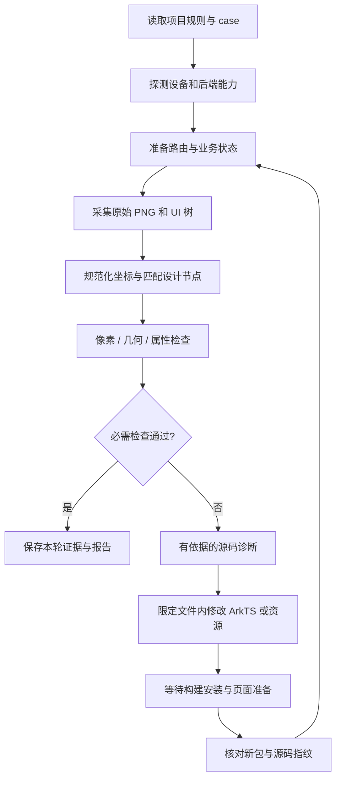

# Harmony / ArkTS 技术选型调研

调研日期：2026-11-10。目标项目：`/Users/yang/meiyou/HarmonyMeetYou`；工具项目：`visual-qa-langgraph`。

本文是选型与实施建议，不代表鸿蒙支持已经实现。此次没有修改 HarmonyMeetYou 或执行 App 构建、安装、页面操作。本机 `hdc` 版本为 `3.2.0f`，设备列表为 `[Empty]`，因此设备端结论仍需实机探针验证。主机验证记录见 [harmony-host-probes-2026-11-10.json](research/harmony-host-probes-2026-11-10.json)。

## 结论

推荐 **Python 平台适配层 + 官方 hdc / UiTest 外部采集 + 按需启用的 ArkUI 调试导出 + LangGraph 构建等待与复验**。

先建立截图、控件树、页面就绪和证据新鲜度链路，再增强样式与源码定位。保留当前 Pillow / NumPy / pixelmatch / SciPy 比较器。第三方自动化驱动作为可替换后端，不作为核心验收链路的硬依赖。

这比仅迁移旧版截图功能更适合实际 ArkTS 修复：截图提供真实显示结果，树与几何数据缩小原因范围，源码映射帮助定位修改，构建证据保证复验对应本轮代码。各证据可以独立降级，但必需项缺失时不能自动算通过。

## 一、项目与现有引擎的实际约束

| 已确认事实 | 对方案的影响 |
| --- | --- |
| `build-profile.json5` 当前最低 API 17、目标 API 20；根文档部分说明仍是 API 12 | 采用 API 17 能工作的基础能力；API 20 增强按设备实际能力启用 |
| `AppScope/app.json5` 包名为 `com.meiyou.hmapp`，主模块 `entry`、入口 `EntryAbility` | 可以生成项目配置模板，但验收仍需核对设备上实际安装包与构建变体 |
| `entry → feature/* → common/uikit + common/sdk`，公共模块含独立 Git 仓库 | 分别限定源码读取、编辑和资源范围，不把单页改动扩成公共模块重构 |
| 页面导航使用 `DynamicsRouter` / `MYRouter`，启动有异步初始化、隐私与广告阶段 | 启动 Ability 不等于业务页面就绪；优先复用已存在的实际路由，否则人工/自动化准备 |
| `WindowUtil` 管理沉浸式窗口、安全区与 px/vp 转换；存在 sm/md/lg 断点 | 必须记录窗口位置、设备密度、安全区、字体缩放、方向与断点 |
| `product/entry/build-profile.json5` 区分 debug / release；`env_test` 仅表示环境 | `env_test` 不自动等于可调试包；沙箱导出与调试钩子需验证 debuggable |
| `hvigorfile.ts` 已注入 BuildNumber，但本地默认值可能只是 `local` | 版本号/BuildNumber 本身不足以证明安装包来自当前修改 |
| `AGENTS.md` 与 `.agent/layers/build.md` 默认要求由用户在 DevEco Studio 构建 | 支持人工构建暂停；自动构建属于后续可配置、需明确授权的项目能力 |
| 项目有 `TestUIDemoPage` / `TestUIKitPage` 等调试入口 | 第一轮可选稳定调试场景，避免从复杂业务链路开始 |
| 存在带品牌水印的应用截图工具 | 外观验收优先采集设备原始画面，不能默认使用应用保存的分享图/水印图 |
| 根依赖中的 `@ohos/hypium` 是 ArkTS 测试依赖 | 不能据此认为官方 Python Hypium 驱动已经安装或可用 |

工具现状也不是只加一个 `platform` 判断即可：

- `engine.py:read_case` 和 `workflow.py:_load_case` 都拒绝非 Web 用例。
- `engine.py:verify_case` 将浏览器采集、DOM/CSS 检查、图片比较写在同一路径。
- `workflow.py:_bind_images` 面向 HTML；`project_policy.py` 只描述 CSS px/rem。
- 诊断包和修复提示面向 DOM/CSS；`repair.py:source_context` 的定位规则面向 HTML/JSX/CSS。
- 修复后的图当前立即返回 preparation/verify；恢复路径会从 START 重新校验。
- `recover_pending_edits` 会回滚 `prepared/applied` 的未验证改动。这对异常恢复正确，但有意等待构建时必须另设持久状态。

## 二、候选技术比较

下表的选型等级是结合本项目作出的工程判断，不是厂商性能结论。

| 方案 | 能提供什么 | 主要成本或边界 | 建议 |
| --- | --- | --- | --- |
| hdc + UiTest CLI | PNG 截图、控件树、部分样式、输入操作 | 不同设备版本参数与属性覆盖需探测；Canvas/WebView/合并节点可能限制定位 | 默认基础后端 |
| ArkUI UIContext / FrameNode 调试导出 | 子树、节点属性、定点几何、部分源码行信息 | 需要 App 内执行与 UIContext；有性能、版本和调试配置约束 | 增强后端，按需接入 |
| 官方 Python Hypium | 控件选择、交互、设备与测试任务管理 | 引入独立运行依赖与测试工程约定；需实测当前 Python/设备组合 | 复杂交互时评估接入 |
| hmdriver2 | Python 元素定位与交互封装 | 当前初始化实现会推送 agent `.so`、处理 UiTest 进程与端口 | 可选适配，不默认启用 |
| DevEco ArkUI Inspector GUI | 人工查看布局、快照与源码跳转 | 此次查到的是 IDE 流程，未找到适合本工具默认依赖的公开稳定自动化协议 | 人工复核与补充证据 |
| 纯截图 + 多模态模型 | 根据画面推断差异原因 | 缺少可重复的几何和源码证据，难区分布局/字体/状态问题 | 辅助诊断 |

官方 [UiTest 文档](https://developer.huawei.com/consumer/en/doc/harmonyos-guides/uitest-guidelines/) 列出了 `screenCap`、`dumpLayout` 和 `uiInput`。其中 `dumpLayout -a` 可包含 BackgroundColor、Content、FontColor、FontSize 和 extraAttrs，不能与 `-i` 同用。它已经比“只有截图”提供更多诊断依据。[OpenHarmony 源仓版本记录](https://github.com/openharmony/testfwk_arkxtest/blob/master/README_zh.md) 也记录了该扩展，但不据此保证当前所有商用设备的属性覆盖一致。

官方 [Python Hypium](https://developer.huawei.com/consumer/cn/doc/harmonyos-guides/hypium-python-guidelines/) 可作为交互后端。[hmdriver2 初始化源码](https://github.com/codematrixer/hmdriver2/blob/master/hmdriver2/_client.py) 则显示了 agent 文件推送、服务启动/停止和端口转发行为。这不等同于修改被测 App，但存在设备环境副作用，所以不把它隐藏在默认 `verify` 中。

## 三、推荐架构



### 1. Python 平台边界

保留公共比较器，拆出 `WebBackend` / `HarmonyBackend`。用明确接口描述 `probe`、`prepare`、`capture`、`snapshot_tree`、`check_readiness`，不让原生检查经过浏览器 DOM 代码。

Harmony 后端细分为：hdc 传输、UiTest 采集、树解析/规范化、原生检查、可选调试导出读取。后端返回能力表，而非假设拥有完整浏览器式属性。

建议能力至少包括：`screenPng`、`uiTree`、`basicStyles`、`inspectorTree`、`geometry`、`sourceLocation`、`runtimeBuildIdentity`。每个能力记录 available/unavailable/unknown 和原因。

同一设备的操作必须串行并持有设备锁；suite 仅对不同设备并发。后台截图、dump 和点击不能互相打断，异常也只清理本轮生成的设备路径。

### 2. 官方外部采集作为默认路径

建议命令形态（设备端尚未在本机验证）：

```sh
hdc -t <device-id> shell uitest help
hdc -t <device-id> shell uitest --version
hdc -t <device-id> shell uitest screenCap -p /data/local/tmp/<run-id>.png
hdc -t <device-id> shell uitest dumpLayout -a -b com.meiyou.hmapp -p /data/local/tmp/<run-id>.json
hdc -t <device-id> file recv /data/local/tmp/<run-id>.png <local-raw.png>
hdc -t <device-id> file recv /data/local/tmp/<run-id>.json <local-tree.json>
```

先看实际 help 与输出，能力不足时明确降级到基本树/视觉检查；case 要求的能力不可用时返回 blocked，不能静默删掉要求。`hdc` 主机版本与设备 `uitest` 版本要分开记录。

首选已明确输出 PNG 的 `screenCap`。`snapshot_display` 可以是经格式与一致性验证的备选，而不是依据文件扩展名假设其内容无损。每次核对图片实际格式、尺寸与解码结果。

UiTest 控件树不是完整 ArkUI 源码树。其节点合并、可访问性信息、可见范围和自绘内容覆盖均需按页面实测；不把缺少的节点等同于不存在。

### 3. 必要时增加调试导出

官方 [UIContext 接口](https://developer.huawei.com/consumer/en/doc/harmonyos-references/arkts-apis-uicontext-uicontext/) 提供 `getFilteredInspectorTree`、`getFilteredInspectorTreeById`；基础接口从 API 12 起可用，`isLayoutInspector` 自定义组件增强需 API 20。应按窗口与目标子树采集，避免在采样循环里反复导出整棵树。

定点几何走 `getUIContext().getComponentUtils().getRectangleById(id)`；针对属性走 `getFrameNodeById(id)?.getInspectorInfo()`。本机 SDK 声明中确认这些能力存在。[FrameNode 官方文档](https://developer.huawei.com/consumer/en/doc/harmonyos-references/js-apis-arkui-framenode/) 给出了节点类型、矩形、属性及调试行信息，且提示频繁调用的性能成本。

实现建议：在测试构建中按请求导出 JSON 到 App 沙箱，通过官方支持的 [hdc 调试沙箱文件传输](https://developer.huawei.com/consumer/en/doc/harmonyos-guides/ide-device-file-explorer/) 拉取。用请求 ID 和完成标记区分新旧结果；先通过调试入口手动触发，自动触发再接独立、受控的测试钩子。无需为首版引入常驻网络调试服务。

“可调试构建 + 显式 QA 开关”才启用导出；仅检测测试环境不够。导出触发不能改变目标页面/新建导航层影响截图，具体触发机制作为真机 PoC 的验证项。

官方 [DebugLine 配置说明](https://developer.huawei.com/consumer/en/doc/harmonyos-guides/ide-run-debug-configurations/) 说明开启后能支持 Inspector 源码跳转；这不是所有节点都可靠具备源码位置的保证。定位优先级建议为：有效 debugLine → 明确 `.id` 与源码映射 → 局部源码候选。

### 4. 统一坐标，而不是统一把数字当 px

保留每份原始证据，并记录：display/window ID、屏幕与窗口尺寸、窗口原点、安全区、截图裁切原点、旋转、密度、字体设置与设计标尺。

- 截图和裁切使用物理 px。
- 设计坐标根据设计定义映射至 ArkUI 逻辑坐标，再转换至设备像素；比例必须显式配置或实际测量。
- [ComponentInfo 文档](https://developer.huawei.com/consumer/en/doc/harmonyos-references/js-apis-arkui-componentutils/) 中尺寸与 offset 使用 px；本机 FrameNode 声明里的某些位置接口则使用 vp。解析层必须保留来源与单位。
- 含 transform 的组件需要处理变换后的边界；仅拿 layout bounds 不能证明最终绘制位置。
- 字体使用当前 UIContext 的转换能力和实际配置校准，不把 fp 固定当成 vp。

对齐时优先用与设计相符的窗口/内容裁切，严格检查结果尺寸。不通过自动找最优缩放、位移或改基准消除差异。可以另做归一化诊断图，但不得替代原始验收证据。

### 5. 双通道验收与分级结论

视觉通道复用现有 pixelmatch、SSIM、差异区域与裁片。几何/属性通道检查关键节点位置、间距、对齐、尺寸、字体和颜色；只对取得可靠数据的属性断言。

全局 SSIM 容易稀释小型关键控件差异，不能单独作为通过标准。使用全局与关键区域联合判定；同设备同状态的截图回归和 Pixso 设计一致性分别记录。图像边界、圆角/阴影、文字抗锯齿的误差要通过固定样例校准，不能自动放宽阈值求通过。

`ready` 至少考虑：目标包与页面身份、业务 loading/错误状态、关键组件出现、几何稳定、截图内容区稳定。连续相同图片只说明画面稳定，不能证明数据已加载正确。

报告分别给出 visual/geometry/style/state/buildFreshness 的 passed/failed/unavailable；`requiredChecks` 指定哪些必需。导入截图仅为 offline_review。像素比较通过不代表完整原生功能验收通过。

### 6. Pixso 与 ArkTS 源码映射

复用设计读取、图片边界和资源缓存；将 `designNodeId → page-scoped inspectorId → .ets 文件/资源` 显式关联。避免用 DOM selector 承载原生选择器，避免用层级序号当长期稳定 ID。

图片通过项目现有资源形式（如 `$r('app.media.xxx')`）落地，并记录资源文件哈希。原有 HTML `bind_images` 不能用于 ArkTS；首版输出资源绑定建议与校验结果，后续再实现专用绑定器。

修复上下文按 `.id`、组件名、资源引用与有效源码位置提取，保留原文件 allowlist。没有依据的节点关联明确标为候选；不把几何重叠就认定为问题源。

### 7. 构建身份与持久暂停是闭环必要条件

建议加入 `awaiting_build` / `awaiting_page_ready`，支持 [LangGraph interrupt / Command](https://docs.langchain.com/oss/python/langgraph/interrupts)。修改源码、等待构建、验证新包分为独立节点，避免恢复时重放源码修改或安装步骤。

必须区分两类恢复：异常恢复继续使用现有事务保护；有意暂停则保留待构建改动、校验其 afterHash，并从等待节点继续。不能让当前 START 重跑逻辑把改动回滚后仍继续验收。

建议最终以构建期写入的 `qaBuildId/sourceDigest` 与设备导出值匹配，关联 HAP 哈希、构建变体、设备与运行轮次。手动确认/安装时间/版本号不足以单独建立源码到运行包的强绑定。没有调试导出时保留人工构建声明及其较低证据级别；本轮修改后的自动完成状态要求新包证据。

回滚也必须经过重新构建与安装后再验收，不能只恢复本地 `.ets` 就把设备上的旧/坏包当作已恢复。

## 四、建议落地顺序与验收门槛

| 阶段 | 交付内容 | 通过条件 |
| --- | --- | --- |
| P0：真机能力 PoC | 能力探针、PNG、基本树/-a 属性覆盖、两轮同步采集样例 | 在实际 API 17 基线及 API 20+ 设备上记录支持/缺失；验证系统控件、弹窗和图片的边界 |
| P1：Python 原生基础验收 | 平台分发、设备锁、原图/裁切、树规范化、像素/基本几何、分级报告 | 设备选择明确；旧证据不复用；错误/缺失能力不误报通过；Web 回归通过 |
| P2：精准诊断与构建衔接 | 调试导出、稳定 ID、样式/源码关联、构建身份、持久等待 | 新旧包能区分；暂停后修改不丢失且不重放；坐标/单位标定通过；调试导出失败有明确结果 |
| P3：受控自动闭环 | 可选构建安装适配、导航动作、ArkTS 修复和回滚复验 | 基于项目实际命令与授权；构建失败先解决编译；修复、回滚都验证运行包与源码对应 |

不建议一开始把整个功能拆成多种重型自动化框架。P1 是可用底座，P2 才是高质量源码修复所需的增强；只有截图的实现不能等同于最终目标。

首批样例建议：稳定文字/卡片页、图片资源页、现有 Dialog/半屏弹窗。后续覆盖滚动列表、键盘、深色模式、平板/折叠屏与混合 WebView。调试页只是起点，最终要在实际业务组件上验证树覆盖与路由准备。

## 五、本次已做验证与仍未验证的事项

已完成的主机实验：

1. 当前 LangGraph `1.2.14` 能在 SQLite 检查点关闭、重新打开后恢复等待节点。
2. 模拟旧 buildHash 时不进入 verify；匹配 buildHash 时才继续，源码修改节点没有重放。此处 hash 为模拟值，仅验证状态控制，不代表实际构建链已接通。
3. 在临时 `.ets` 文件上验证现有 `recover_pending_edits` 确实会回滚 applied 改动，证明原生等待流程必须调整事务恢复语义。
4. 从本机 SDK 声明确认 UIContext / FrameNode 相关方法存在；这不代替最低系统版本的运行验证。
5. 读取 `hdc -v` 与 `hdc list targets`：主机工具可执行，当前无连接设备。

未验证：实际截图性能与稳定性、特定设备 `-a` 输出结构、窗口/系统弹窗坐标、源码行覆盖、调试沙箱导出触发、实际构建指纹注入、Python Hypium 在当前运行环境的兼容性、Canvas/WebView/视频层的节点覆盖。接入前应以 P0 小样例回答这些问题，不提前承诺全量自动化可用。
