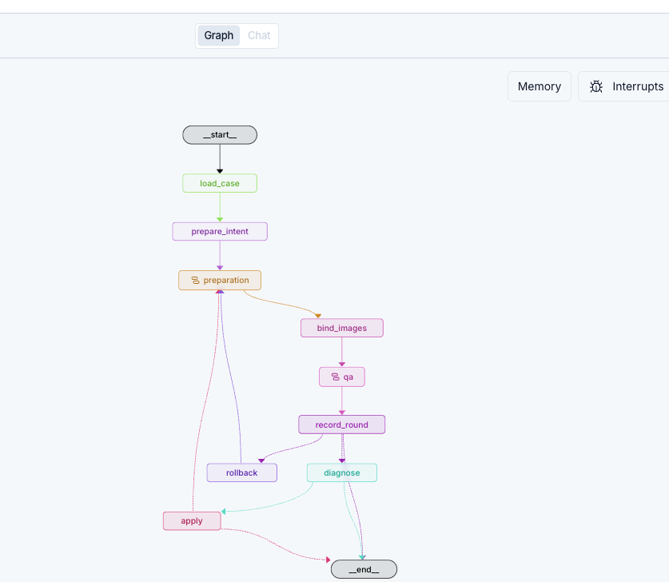

# Visual QA LangGraph 流程说明

[返回项目 README](README.md)



这张图描述的是“验收已有页面，必要时修正，再重新验收”的过程。先沿上半部分从上往下读，到 `record_round` 后，再根据当前验收结果选择结束、诊断或回滚。图上的实线表示固定的执行顺序，虚线表示根据状态选择的条件分支；一次运行只走满足条件的分支。

## 每个节点负责什么

| 图中节点 | 作用 | 主要结果或行为 |
| --- | --- | --- |
| `__start__` | 图的入口。 | 将 Studio 提交的输入状态送入 `load_case`。 |
| `load_case` | 读取 case JSON，检查 Web 平台和设计图配置；传入 `project_skill` 时读取 CSS 单位、Flex 等项目策略并应用到 case。 | `case`、`project_policy`；有项目策略时保存策略及 scaffold 配置。 |
| `prepare_intent` | 传入 `annotated_image` 时识别红框，生成“这些区域应作为整张图片”的意图计划。未传标注图时直接继续。 | `red-image-intent.json`；此阶段识别意图，Pixso 节点匹配在设计准备阶段完成。 |
| `preparation` | 准备设计、素材和源码上下文的子图，内部两条分支并行执行，最后汇合。 | `design`、`source` 和本轮输入指纹 `fingerprint`。 |
| `bind_images` | 有红框图片任务时，将导出的 3x PNG 绑定到静态 HTML 对应元素，并刷新源码指纹。没有这类任务时跳过图片写入。 | 更新 HTML、图片资源；有项目策略或标注图时生成 `effective-case.json`。 |
| `qa` | 执行验收并整理修正包的子图。 | `verification` 和精简后的 `packet`，以及截图、差异图等证据。 |
| `record_round` | 记录本轮状态、像素差异、SSIM 和源码哈希，并与上一轮比较，判断是否需要回滚。 | 更新 `rounds`，保存 `rounds.json`，设置 `rollback_requested`。 |
| `diagnose` | 调用 `model_name` 指定的模型解释失败原因。启用 `auto_fix` 时，还让模型提出限定文件内的精确修改。 | `diagnosis`、`edits`、模型用量，以及 `diagnosis.md`。 |
| `apply` | 检查模型修改的路径、源码哈希和唯一匹配，备份后执行 `find/replace`。 | `apply_result`、`apply-N.json`、`backups/fix-N/`，并增加修正尝试次数。 |
| `rollback` | 恢复刚才导致指标恶化的那次修改，然后回到 `preparation`。 | 文件恢复后重新准备上下文、绑定图片并验收。 |
| `__end__` | 本次图执行结束。 | 是否通过仍要检查 `verification.status` 和 `verification.mode`。 |

这些节点通过同一个 `RunState` 传递数据：前面的节点写入设计、源码和验收结果，后面的节点读取并补充状态。模型调用集中在 `diagnose`；其余节点执行本地代码、浏览器操作或 Pixso 工具读取。`bind_images` 的图片写入由标注图任务触发，`auto_fix` 控制的是模型提出的源码修改。

## 两个折叠子图里面是什么

`preparation` 和 `qa` 旁边的子图标记表示内部还包含节点。它们在主图中折叠显示，内部连接如下，名称与代码一致：

```text
preparation
  __start__ ─┬─ prepare_design ─┐
             └─ prepare_source ─┴─ join → __end__

qa
  __start__ → verify → make_packet → __end__
```

`prepare_design` 检查本地设计图、意图计划及素材；配置 Pixso 后还会匹配图片节点、读取设计并导出素材。`prepare_source` 扫描指定源码，计算文件哈希并检查本地资源引用。两者都完成后，`join` 合成输入指纹。这里并行的是设计和源码准备。

`verify` 在真实页面模式下启动或连接浏览器，检查截图差异、SSIM、资源加载、布局稳定性、控制台及已配置的 CSS、DOM 和设计测量规则；传入 `offline_actual` 时只进行离线图像比较。随后 `make_packet` 将验收结果整理成有数量和大小限制的修正包，保存为 `repair-packet.json`，供模型诊断使用。

## 下半部分为什么有多条分支

`record_round` 按下表顺序判断，命中后就选择对应出口：

| 优先级 | 条件 | 下一步 |
| --- | --- | --- |
| 1 | 上一次修改已应用、本轮仍未通过，且像素差异率比上一轮增加 **超过 0.15 个百分点**。 | `rollback → preparation`，恢复后重新验收。 |
| 2 | 本轮 `status` 为 `passed`，且 `mode` 为 `final`。 | `__end__`，最终验收通过。 |
| 3 | 启用了 `auto_fix`，且 `fix_count` 已达到 `max_fixes`（默认 2）。 | `__end__`，停止继续修正。 |
| 4 | 前面的条件均不满足，且配置了 `model_name`。 | `diagnose`，让模型分析。 |
| 5 | 前面的条件均不满足，也没有配置模型。 | `__end__`，保留当前验收结果。 |

例如，修改前像素差异率为 `2.30%`，修改后为 `2.60%`，增加了 `0.30` 个百分点；如果本轮仍未通过，就会触发回滚。回滚后仍需重新验收，已消耗的修正尝试次数也会保留。

`diagnose` 有两个出口：仅诊断（`auto_fix: false`），或模型没有给出可解析的修改时，直接结束；只有 `auto_fix: true` 且 `edits` 非空时，才进入 `apply`。`apply` 成功后回到 `preparation`，重新读取修改后的源码，再经过 `bind_images → qa → record_round`；修改被拒绝时结束。

因此，一次常见的自动修正过程是：

```text
读取用例 → 准备意图 → 准备上下文 → 绑定图片 → 验收 → 记录失败
         → 模型诊断 → 应用修改
         → 重新准备上下文 → 绑定图片 → 重新验收 → 记录通过 → 结束
```

**走到 `__end__` 只表示执行结束。** 没有模型、修正次数耗尽、模型没有修改建议、修改被拒绝，以及离线诊断，都可能正常到达终点。最终验收通过必须同时满足 `verification.status == "passed"` 和 `verification.mode == "final"`；离线比较即使差异为零，也只会得到 `offline_review`。

节点说明与分支条件对应 [workflow.py 中的状态、节点和图定义](src/visual_qa_graph/workflow.py)。

